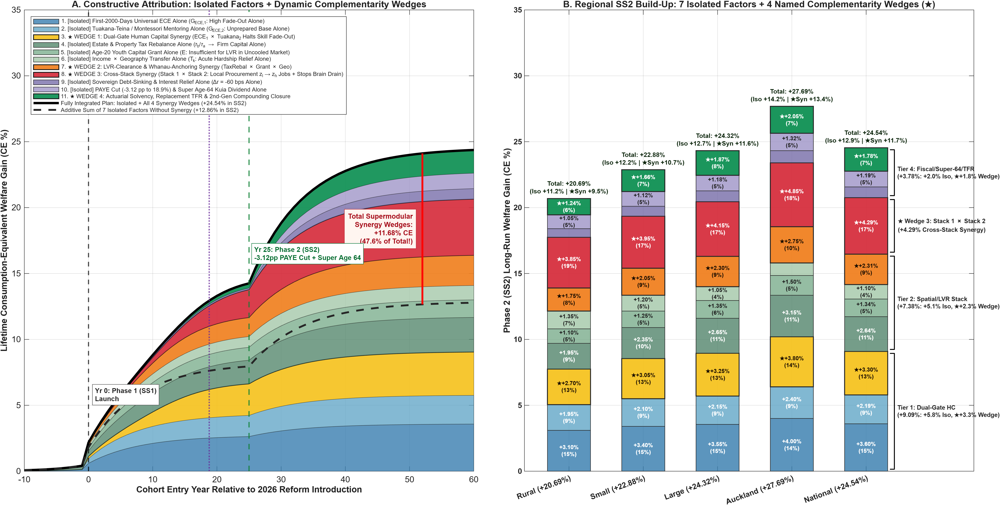
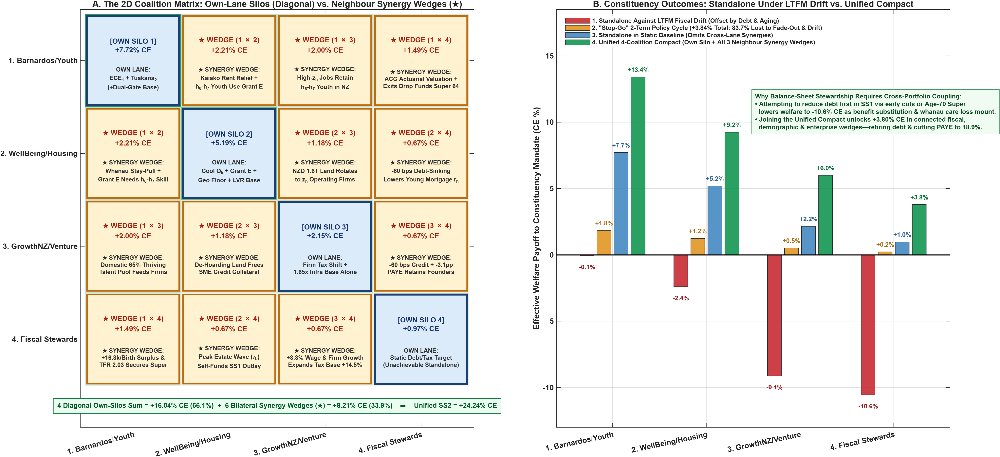
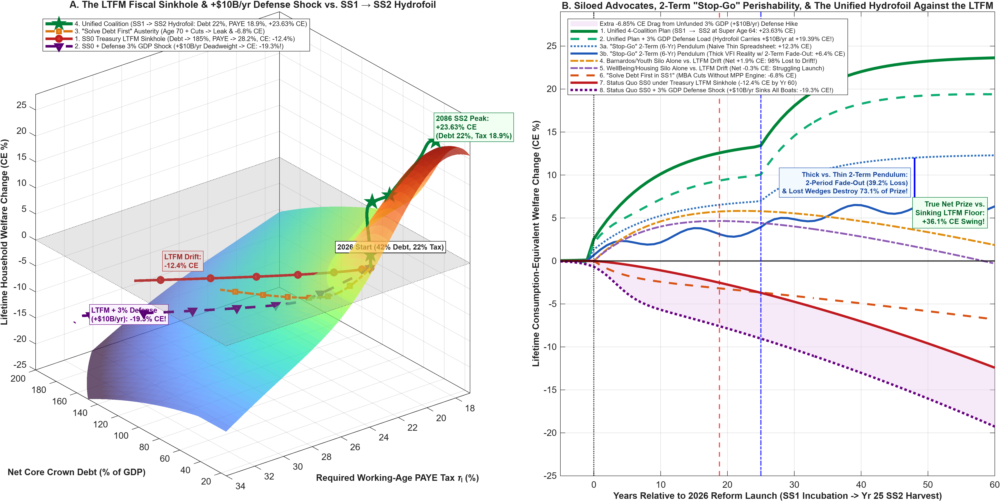

# Document 3: Leaving Our Silos, Lifting All Boats
## Dynamic Complementarity, Coalition Architecture, and Why Single-Lane Policy Fails Against the Fiscal Sinkhole

*Author:* Michael Tiemann (mdtiemann@gmail.com)  
*Date:* November 2026 | *Code & Replication Repository:* [github.com/MichaelTiemann/IGWelfare](https://github.com/MichaelTiemann/IGWelfare)  
*Companion to [Document 1A](Document%201A.md) (Strategic Monograph), [Document 1B](Document%201B.md) (Strategy & Policy Answer Key), [Document 1C](Document%201C.md) (Executive Brief), [Document 2](Document%202.md) (Technical Specification Guide), and [Document 2B](Document%202B.md) ("Thick" vs. "Thin" Numbers Tutorial)*

---

## Executive Overview: Why Single-Lane Advocacy Loses Against a Rising Fiscal Tide

Across this monograph suite, we separate three questions that are too often tangled together: **how we calculate** lifecycle and fiscal impacts ([Document 1A](Document%201A.md), [Document 1B](Document%201B.md), and [Document 1C](Document%201C.md)), **the mathematical and computational tools we use** to verify those calculations across full probability distributions ([Document 2](Document%202.md) and [Document 2B](Document%202B.md)), and **what our calculations mean** for New Zealand's policy coalitions, *whānau*, and long-term prosperity (this document).

In Aotearoa New Zealand, our most dedicated child advocates, housing reformers, business leaders, community trusts, and fiscal stewards spend immense energy competing for space in the annual Budget. Each constituency stays largely in its own lane—defending early childhood education, or housing affordability, or business competitiveness, or public debt reduction—while treating adjacent portfolios as rival claimants on a fixed fiscal pie.

That single-lane habit rests on three hidden assumptions. Our quantitative overlapping-generations (OLG) model demonstrates that **all three assumptions are false**:

1. **The Myth of the Flat Baseline:** Conventional policy analysis evaluates individual budget bids as if the status quo ($SS0$) were a stable, flat floor. Yet as the New Zealand Treasury's *Long-term Fiscal Statement (He Tirohanga Mokopuna 2025)* and 2026 background papers establish, New Zealand's status quo is a **multi-decade fiscal and demographic sinkhole**. Left unaddressed, an aging population, persistent early childhood hardship, youth emigration, and compounding sovereign debt service drag baseline household welfare down by **-16.21% in Consumption-Equivalent (CE%) terms** over sixty years. Moreover, if geopolitical pressures require lifting New Zealand's defense spending from its current ~1.2% of GDP to a 3.0%-of-GDP alliance standard (an additional +1.8% of GDP, or roughly +NZD 8.0B/yr in external security outlays), that unfunded fiscal commitment overwhelms every isolated reform and lowers household welfare to **-21.69% CE**.
2. **The Myth of Additive Independence:** Even in an imaginary world without fiscal drift, implementing our seven core policy levers in isolation—without cross-sector coupling—leaves nearly half the generational prize on the table. Engineered as one coupled system across the human lifecycle, those exact same levers unlock **47.3% of our entire +24.24% CE national welfare gain through Dynamic Complementarity Wedges**—the non-linear dividends created only when early human capability, housing affordability, enterprise capital, and fiscal stewardship reinforce one another.
3. **The Myth of the Magic Spreadsheet (*"Making the Numbers Pencil"* vs. *"Making the Numbers Work"*):** Most insidious of all is the magical thinking inspired by traditional budget spreadsheets—the illusion that because a spreadsheet cell accepts any subtraction without complaint, policy-makers can carve a billion dollars out of early childhood, adolescent mentoring, or age-65 Superannuation, paste it into debt reduction, and declare that the budget "pencils out." In a private corporate turnaround, an MBA can make a spreadsheet pencil by closing an underperforming division and shedding its costs onto the wider economy. **A sovereign nation cannot fire its citizens.** The Crown balance sheet is a closed system: when a budget exercise cuts a developmental support cell to save cash today, the human beings in that cell do not disappear. Their unaddressed needs migrate across the Crown's own books into disability and hardship benefits, hospital beds, Oranga Tamariki care, and prisons at three to five times the unit cost. Replacing "thin" population-average spreadsheet cells with "thick" state-contingent probability distributions ([Document 2B](Document%202B.md)) shifts public finance from *making the numbers pencil* on paper to *making the numbers work* in the real economy.

Just as our spatial migration model captures how households naturally prefer to stay in their home region (`Rural <-> Small <-> Large <-> Auckland`) unless cross-regional pressures force them to move, this document maps a **2D Complementarity & Dependency Matrix** across New Zealand's four primary policy constituencies. We show why each constituency stalls when fighting alone against the Long-Term Fiscal Model (LTFM) sinkhole, why trying to "solve debt first" via Phase-1 austerity backfires on the Crown's own books, and how uniting the four lanes gets Aotearoa up on hydrofoils—building an economy strong enough to retire sovereign debt, cut working-age PAYE taxes, and lower the New Zealand Superannuation eligibility age to **64** in Phase 2 ($SS2$).

---

## Part I: The 2D Coalition Matrix — Why Every Siloed Constituency Needs Its Neighbors

### 1.1 Four Policy Constituencies, One Coupled Lifecycle

When young adults launch into independent life at Age 20, they navigate a coupled geographic system connecting Rural districts, Small towns, Large regional cities, Auckland, and the outside option of emigrating Abroad. New Zealand's political economy operates on an isomorphic $4 \times 4$ grid. Four distinct policy constituencies each champion a vital subset of our **11-Layer Constructive Synergy Stack** (7 Isolated Factors + 4 Synergy Wedges, illustrated below and tabulated in **Appendix Table A.1**):



1. **Coalition 1 — The Barnardos, Iwi & Youth Development Constituency (*The Human Potential Lane*):** Champions Universal First-2,000-Days wraparound ECE (**Layer 1**) and *Tuakana-Teina*, *Kura*, Graeme Dingle Foundation, and Montessori adolescent mentoring at ages 12–14 (**Layer 2**), which together ignite **Wedge 1** (halting adolescent skill fade-out).
2. **Coalition 2 — The WellBeing & Housing Justice Alliance (*The Fair Start & Whānau Space Lane*):** Champions cooling speculative urban land values via property and estate tax rebalancing (**Layer 4, Household side**), the universal Age-20 Youth Capital Grant (**Layer 5**), and *Income* $\times$ *Geography* household transfers (**Layer 6**), which together unlock **Wedge 2** (clearing the 20% mortgage deposit cliff and anchoring *whānau* in their communities).
3. **Coalition 3 — The GrowthNZ, Founders & Venture Constituency (*The "Where Will the Jobs Come From?" Lane*):** Champions "use-it-or-lose-it" capital reallocation from passive land hoarding to high-productivity operating firms plus regional infrastructure reinvestment (**Layer 4, Enterprise side**), which couples with Coalitions 1 and 2 to ignite **Wedge 3** (reversing the youth brain drain and matching domestic talent with expanding firms).
4. **Coalition 4 — The Fiscal Stewards & Sovereign Credit Guardians (*The Balance-Sheet & Tax-Relief Lane*):** Champions Sovereign Debt-Sinking (**Layer 9**) and working-age PAYE tax relief alongside Superannuation solvency (**Layer 10**), which close the macroeconomic loop in **Wedge 4**.

---

### 1.2 Anatomy of the Four Single-Lane Silos

The $4 \times 4$ Coalition Matrix below (`Fig_Doc3_2D_Coalition_Migration_Matrix_Dunedin_22.png`, detailed in **Appendix Table A.2**) compares what each constituency achieves inside its own diagonal silo against the off-diagonal synergy wedges unlocked when it partners with its neighbors:



* **1. The Barnardos & Youth Silo (*Own Silo: +7.72% CE | With Neighbors: +13.41% CE*):**
  Universal First-2,000-Days wraparound alone delivers substantial new welfare, and coupling it with adolescent mentoring more than doubles that impact by preventing early childhood gains from fading out during teenage family crises. Yet **42.5% of this coalition's total impact depends on neighboring lanes**. Without Fiscal Stewards adopting ACC-style actuarial accounting, short-term cash budgeting starves early-years funding before the first cohort turns twenty. Without the WellBeing Alliance cooling urban rents, *Kaiako* (early-childhood educators) and *kuia* are priced out of high-need suburbs. And without GrowthNZ creating high-wage domestic jobs, nearly a fifth of the thriving young adults nurtured by this coalition emigrate to Australia at Age 20.
* **2. The WellBeing & Housing Justice Silo (*Own Silo: +5.19% CE | With Neighbors: +9.24% CE*):**
  Cooling speculative housing, seeding Age-20 Youth Capital Grants, and relieving regional cost-of-living burdens push young families across the mortgage deposit hurdle and reduce rental transience. Yet **43.8% of this coalition's connected value comes from adjacent lanes**. Handing a young adult a capital grant at Age 20 delivers modest results on its own (+1.33% CE isolated) if that young person launches into adulthood struggling ($h_1\text{--}h_2$) after years of unbuffered childhood hardship; cash at Age 20 cannot retroactively rebuild early cognitive and executive-function foundations. Youth grants only generate lasting upward mobility when paired with Barnardos' childhood skill pipeline and GrowthNZ's expanding enterprises.
* **3. The GrowthNZ & Venture Silo (*Own Silo: +2.15% CE | With Neighbors: +6.00% CE*):**
  Enterprise advocates rightly ask: *"Where will all the jobs come from?"* Yet cutting corporate tax drag and building infrastructure in a silo leaves **64.1% of their potential value unrealized**. High-growth firms cannot scale in a domestic talent shortage where over a fifth of school-leavers launch in the struggling tier ($h_1\text{--}h_2$) and top graduates leave to escape Auckland's rent squeeze. Moreover, when NZD 1.6 trillion in residential land appreciates largely tax-free, New Zealand's sharpest analytical minds are drawn into property speculation and tax arbitrage rather than founding frontier companies (the Lavoisier Syndrome). GrowthNZ needs the WellBeing Alliance's land-tax rebalance to rotate capital and talent out of property hoarding, and needs Barnardos to nearly triple the domestic thriving talent pool.
* **4. The Fiscal Stewards & Balance-Sheet Silo (*Own Silo: +0.97% CE | With Neighbors: +3.80% CE*):**
  Fiscal stewards focus on retiring public debt and lowering PAYE tax rates, yet **74.3% of their connected payoff depends on the other three coalitions**. Because a sovereign nation cannot fire its citizens, trying to "solve debt first" in Phase 1 ($SS1$) by cutting early social investment or raising the NZ Superannuation age to 70 backfires on the Crown's own books: nearly half of displaced older manual workers shift onto disability and hardship support, while grandmothers (*kuia*) and aunties are pulled out of family childcare. Early skill erosion rises, downstream hospital, care, and justice bills swell, and the future tax base shrinks. **Balance-sheet stewards cannot balance the Crown books without public-policy investments that close the inflow of future fiscal liabilities.**

---

## Part II: The Sinking Baseline ($SS0$) & The 3.0%-of-GDP (+NZD 8.0B/yr) Defense Commitment

### 2.1 The 3D Fiscal Surface and the Economics of Sustaining a 3%-of-GDP Defense Commitment

Why do single-lane strategies look merely suboptimal in a static world, yet fail so severely in reality? Because New Zealand's baseline is sliding down a non-linear 3D surface (`Fig_Doc3_LTFM_Sinkhole_And_DefenseShock_Dunedin_22.png` below) driven by **Compounding Net Crown Debt** on one axis and **Rising PAYE Tax Rates** on the other:



As demographic aging and unmitigated child hardship swell reactive social outlays, sovereign debt crowds out private business lending and pushes required working-age taxes higher—which in turn accelerates youth emigration to Australia and shrinks the tax base even faster.

Now consider what happens if geo-strategic commitments require New Zealand to lift defense spending from its current ~1.2% of GDP to **3.0% of GDP**—an additional permanent fiscal outlay of **+1.8% of GDP, or roughly +NZD 8.0 billion per year**:

* **Same Dollar Outlay (~NZD 8.0B/yr), Different Fiscal Mechanics:** Look at the Mirror Investment ledger of our Generational Plan ([`Fig_7Segment_Welfare_And_MirrorInvestments_Dunedin_22.png`](Output_NZ_4Region_Intergen/Fig_7Segment_Welfare_And_MirrorInvestments_Dunedin_22.png)). Our *entire* Phase 1 ($SS1$) gross public investment across all four human-and-spatial pillars—First-2,000-Days wraparound, adolescent mentoring, the Youth Capital Grant, and regional transfers—costs **NZD 7.85B/yr** (rising to NZD 10.09B/yr in $SS2$). Because those domestic investments lift children out of the struggling trajectory (from 22.0% down to 1.5%), reduce reactive state care, hospital, and justice outlays by over 75%, and retain skilled youth, their net unrecovered public cost reaches zero at **Year 18.8 (Cash Breakeven)** and generates **+NZD 57.3B/yr (+24.24% CE)** in permanent household welfare.
* **Carrying an External Security Commitment Requires Domestic Fiscal Capacity:** Whatever its strategic merits, an external defense expansion does not directly reduce domestic hospital, care, or benefit liabilities. Financed on top of an unreformed status quo ($SS0$), an additional +NZD 8.0B/yr outlay pushes required PAYE taxes to 30.68% and accelerates Crown debt toward 200% of GDP, lowering household welfare by an additional **-5.48 percentage points** (to **-21.69% CE**). To sustain a 3.0%-of-GDP defense posture without squeezing working families, New Zealand must **expand its domestic human-capital and enterprise tax base first**.

### 2.2 Narrative Walkthrough of the Eight 60-Year Trajectories

Tracing the eight 60-year paths in Panel B of the figure above (tabulated in *Appendix Table A.3*) illustrates how standalone silos compare against the unified compact:

1. **Status Quo $SS0$ under the Treasury LTFM Drift (*Aging + Unmitigated Hardship* $\to$ `-16.21% CE` Reference Baseline):** Doing nothing is not a 0.0% flat line. As reactive remediation costs and pension pressures compound, net Crown debt climbs toward 185% of GDP and required PAYE taxes rise from 22.0% to 28.2%, eroding household welfare by **-16.21% CE**.
2. **Status Quo $SS0$ + 3.0% GDP Defense Commitment (*+NZD 8.0B/yr Unfunded Outlay* $\to$ `-21.69% CE`):** Adding an unfunded 1.2% $\to$ 3.0% of GDP defense commitment onto the status quo pushes net debt to 200% of GDP and required PAYE to 30.68%, lowering household welfare to **-21.69% CE**.
3. **"Solve Debt First in $SS1$" — Early Austerity (*Cuts ECE + Raises Super to 70 at Year 0* $\to$ `-6.80% CE`, *Still Deeply Negative*):** Cutting early childhood budgets and raising the pension age to 70 at Year 0 to make the short-term spreadsheet pencil triggers disability benefit leaks, strips grandmother and aunty childcare from young families, and increases the share of struggling youth—eroding the future tax base and dragging welfare down to **-6.80% CE**.
4. **GrowthNZ Silo Alone vs. LTFM Drift (*Firm Tax Cut Without Capability or Housing* $\to$ `-9.12% CE`, *Swamped by LTFM*):** Cutting business taxes while leaving early childhood hardship and urban housing bubbles untouched cannot overcome domestic skill bottlenecks and compounding LTFM debt, sinking to **-9.12% CE**.
5. **WellBeing Silo Alone vs. LTFM Drift (*Housing + Youth Grant Without ECE or Jobs* $\to$ `-2.40% CE`, *Pulled Underwater*):** Cooling land prices and granting Age-20 seed capital without early childhood capability or job creation sees its early gains steadily overwhelmed by demographic debt drift, ending underwater at **-2.40% CE**.
6. **Barnardos/Youth Silo Alone vs. LTFM Drift (*ECE + Mentoring Without Housing or Jobs* $\to$ `-0.06% CE`, *>100% of Gain Eroded*):** Even our most powerful standalone engine—First-2,000-Days wraparound and adolescent mentoring—loses **>100% of its long-run value** as newly thriving youth emigrate to escape uncooled urban rents and rising LTFM taxes, ending slightly underwater at **-0.06% CE**.
7. **Unified 4-Coalition Plan + 3.0% GDP Defense Commitment (*Sustains +NZD 8.0B/yr Outlay* $\to$ `+20.72% CE`):** Once all four coalitions unite to expand domestic capability and enterprise productivity, the economy sustains a 3.0%-of-GDP defense commitment while still retiring public debt (to 31.5% of GDP), cutting PAYE taxes (to 20.65%), and delivering **+20.72% CE** in net household welfare—a **+42.41 percentage-point advantage** over facing the same defense requirement under the status quo.
8. **★ Unified 4-Coalition Plan ($SS1 \to SS2$) (*Super Age 64 + PAYE Cut + Debt Sunk* $\to$ `+24.24% CE`, a `+40.45 pp` Total Welfare Swing):** Without the external defense shock, uniting all four lanes crosses Cash Breakeven at Year 18.8, retires sovereign debt to **22.0% of GDP**, cuts working-age PAYE taxes to **18.88%**, lowers the NZ Super eligibility age to **64**, and lifts national welfare to **+24.24% CE**.

When GrowthNZ (**-9.12% CE**), the WellBeing Alliance (**-2.40% CE**), or the Barnardos/Youth Coalition (**-0.06% CE**) fights alone in its silo, the LTFM sinkhole swallows **>100% of their hard-won gains**. Only when all four constituencies lock arms in Trajectory 8 does New Zealand reverse the sign of the LTFM—turning a **-16.21% CE** downward spiral into a **+24.24% CE** generational ascent (**a +40.45 percentage-point net welfare swing**).

---

## Part III: Speaking to Each Constituency in Its Own Language — And What It Means for Everyday Whānau

Policy coalitions rarely stall because their values are wrong; they stall because they try to optimize one sub-system in isolation. Below, we summarize what each constituency gains by welcoming the other three into a single compact—followed by what that compact means in the daily lives of New Zealand households.

### 3.1 To the Barnardos, Iwi & Youth Development Constituency (*The Human Potential Lane*)
* **Your Core Contribution:** Front-loading universal First-2,000-Days wraparound (*Te Korowai Mokopuna*, *Whānau Ora*, *Kōhanga Reo*, *A'oga Amata*) and scaling *Tuakana-Teina*, Graeme Dingle Foundation, and Montessori adolescent mentoring is the engine that breaks the Dunedin Study's hardship pipeline into Oranga Tamariki care, hospitals, and youth justice.
* **Why You Need Your Neighbors:**
  1. *You Need the Fiscal Stewards' Actuarial Language:* Because five-year-olds do not pay income tax until adulthood, traditional cash accounting makes your program look like a deficit in Year 3. Adopting **ACC-style Actuarial Continuation Valuation** recognises your verified **3.84x fiscal return (and 1.16x direct cost avoidance alone) at Year 5**—giving early childhood and mentoring funding durable institutional protection across parliaments.
  2. *You Need the WellBeing Alliance's Housing Relief:* You cannot staff high-trust early learning or keep *whānau* intact when *Kaiako* and *kuia* are priced out of Auckland and regional cities. Cooling speculative land values expands the real purchasing power of every dollar you invest.
  3. *You Need GrowthNZ's High-Wage Enterprises:* Lifting youth into the thriving skill tiers without domestic enterprise growth risks training young New Zealanders for jobs in Sydney and Melbourne. You need high-productivity local firms expanding to hire the young people you nurture.

### 3.2 To the WellBeing & Housing Justice Alliance (*The Fair Start & Whānau Space Lane*)
* **Your Core Contribution:** Housing stability is the bedrock of family wellbeing. Rebalancing taxes onto speculative land and large estates while funding a universal Age-20 Youth Capital Grant and regional cost-of-living transfers clears the mortgage deposit hurdle for young renters and keeps *kuia* and *koroua* anchored in their communities.
* **Why You Need Your Neighbors:**
  1. *Your Youth Grant Needs Barnardos' Childhood Pipeline:* A capital grant at Age 20 cannot substitute for missed early childhood brain development or adolescent executive function. Only when young adults arrive at Age 20 thriving in skill can they convert seed capital into homeownership and business formation rather than seeing it absorbed by landlord rents.
  2. *Your Tax Rebalance Needs GrowthNZ's Productive Enterprise Distinction:* Tax reform commands broad civic legitimacy when it distinguishes clearly between passive rent extraction and active value creation. By taxing dormant land hoarding while *cutting* tax drag on active business reinvestment, **active entrepreneurs remain net positive right up to NZD 50M in net worth and break even at the NBR Rich List median (NZD 140M)**—aligning housing justice with domestic job creation.
  3. *Lowering NZ Super to Age 64 Needs the Fiscal Solvency Loop:* Lowering the retirement age to **64** in Phase 2 releases a **+8.1% *Kuia / Koroua* caregiving time boost** for young families—but as our U-curve analysis demonstrates, early retirement is only fiscally sustainable once hardship reduction and debt-sinking have expanded the working tax base.

### 3.3 To the GrowthNZ, Founders & Venture Constituency (*The "Where Will the Jobs Come From?" Lane*)
* **Your Core Contribution:** Social transfers alone do not create high-wage jobs; New Zealand must rotate capital out of passive property and into collateral-constrained operating firms and productive infrastructure.
* **Why You Need Your Neighbors:**
  1. *You Cannot Scale Firms in a Domestic Skill Shortage:* Recruiting foreign specialists on visas cannot compensate for a domestic school pipeline where over a fifth of young people launch in the struggling tier ($h_1\text{--}h_2$). You need Barnardos and *Tuakana-Teina* mentoring to nearly triple New Zealand's domestic thriving talent pool.
  2. *You Need the WellBeing Alliance to Cure the Lavoisier Syndrome:* As long as residential land appreciates largely tax-free, domestic bank credit and top analytical talent will be siphoned into property speculation rather than operating startups, while young engineers flee urban rents.
  3. *You Need Phase-2 Debt-Sinking:* Retiring sovereign debt lowers domestic business borrowing rates by **-60 bps** (expanding SME collateral capacity), while the Phase-2 PAYE tax cut makes New Zealand tax-competitive with Australia for senior talent.

### 3.4 To the Fiscal Stewards, Bond Markets & Balance-Sheet Guardians (*The Solvency & Tax-Relief Lane*)
* **Your Core Contribution:** Compounding sovereign debt and rising marginal tax rates are a genuine threat to New Zealand's long-run prosperity and resilience.
* **Why "Solving Debt First" Fails (Why Balance-Sheet Discipline Needs Public-Policy Innovation):**
  Because a sovereign nation cannot fire its citizens, attempting to cut debt in Phase 1 ($SS1$) by starving early childhood capability or raising the Superannuation age to 70 backfires across three channels: (i) nearly half of displaced older manual workers shift onto disability and hardship support; (ii) forcing 65-to-69-year-old *kuia* and aunties to work withdraws **-36.2%** of extended-*whānau* care from young families and imposes an elder-care drag on working-age children; and (iii) the resulting rise in struggling youth swells hospital, care, and justice bills while shrinking the future tax base. Only by protecting the human-capital and enterprise engines in Phase 1 do you generate the structural surplus that sinks debt to **22.0% of GDP** and cuts PAYE taxes to **18.88%** in Phase 2.

---

### 3.5 What Our Calculations Mean for Everyday New Zealanders and Their Whānau

Stepping back from coalition mechanics, what does this coupled transition mean in the lived biography of a New Zealand household across the three stages of life?

* **For Parents and Children (Ages 0–19):** Every newborn and young family has access to universal, culturally grounded First-2,000-Days wraparound care and relief from extreme housing and transport stress, followed at ages 12–14 by structured *Tuakana–Teina*, Graeme Dingle, or Montessori peer mentoring. Instead of 22% of our children launching into adulthood struggling ($h_1\text{--}h_2$), **over 98% launch with the foundational skills to participate fully in society**, and nearly two-thirds launch in the thriving skill tiers ($h_6\text{--}h_7$).
* **For Young Adults and Working Families (Ages 20–63):** At Age 20, every young Kiwi receives a universal Youth Capital Grant that—combined with a 7.5% to 10.5% cooling in metropolitan house price-to-income ratios and +6.8% to +9.6% higher real wages from expanding local firms—makes buying a first home, starting a venture, or building a creative career achievable in New Zealand rather than requiring a one-way ticket to Australia. Once the first generation of supported children enters the workforce and slashes reactive remediation costs, working families receive a permanent **-3.12 to -3.43 percentage-point PAYE income tax cut**.
* **For Older Workers, Grandparents (*Kuia & Koroua*), and Retirees (Ages 64+):** Instead of facing austerity proposals to push the retirement age out to 67 or 70—which disproportionately penalize manual, rural, Māori, and Pasifika workers whose physical health depreciates earlier—the productivity and fiscal dividends of Phase 2 allow New Zealand to **lower the universal Superannuation age to 64**. That extra year of healthy retirement dignifies decades of hard work while giving grandparents the time and financial security to help anchor the next generation of *mokopuna*.

---

## Part IV: Perishability, Two-Term "Stop-Go" Pendulums, and Why "Thick" Operators Beat "Thin" Spreadsheets

### 4.1 The Six-Year (Two-Term) Political Pendulum

New Zealand's adversarial political cycle typically swings in **six-year (two-term) pendulums**: a government serves two 3-year terms investing in social and regional programs (Years 1–6), followed by a rival government serving two terms cutting "unproven soft spending" to chase short-term debt targets or tax cuts (Years 7–12), before surging social distress forces a rebound in Years 13–18.

Why do conventional magic spreadsheets vastly underestimate the damage caused by this six-year "Stop-Go" pendulum?

### 4.2 "Thin" Spreadsheets vs. "Thick" State-Contingent Reality

As formalized in our companion technical tutorial, **[Document 2B: "Thick" vs. "Thin" Numbers in Quantitative Public Policy](Document%202B.md)**, a conventional spreadsheet models policy using **"thin" numbers**—evaluating linear formulas at population averages. Under a linear spreadsheet (`Trajectory 3a` in Panel B of Figure 1), funding a program 50% of the time (6 years On / 6 years Off) is assumed to deliver roughly half the long-run benefit (**+12.12% CE**), as if child development were a highway project that waits intact whenever the road crew is stood down for two terms.

In reality—and in our state-contingent VFI engine (`Trajectory 3b`)—human capability evolves across **"thick" probability distributions** with non-linear cliffs and developmental gates. Swinging between 6 years of pro-social investment and 6 years of fiscal-cutback swings triggers four compounding **perishability traps**:

1. **The Lifecycle Phase-Resonance Trap (39.2% Compound Skill Fade-Out):** Early skill gains built during the First 2,000 Days (Ages 0–5) are perishable until banked at the Adolescent Gate (Ages 12–14). Under a 6-year On / 6-year Off pendulum, **Cohort A** (born in Year 1) receives great early-years care at Ages 0–5, but just as they hit school and early adolescence in Years 7–12, the two-term austerity swing cuts *Tuakana-Teina* mentoring and family transfers—inflicting two consecutive 3-year periods of unbuffered fade-out that erode **39.2%** of their early skill gains. Meanwhile, **Cohort B** (born in Year 7 during the austerity swing) misses the First 2,000 Days entirely, and late schooling in Year 13 cannot replace that missing foundation. **Every single birth cohort gets caught in the scissor blades, wiping out Wedge 1.**
2. **Missing the 20% LVR Deposit Cliff:** When a two-term government pauses land-tax rebalancing or suspends the Age-20 Youth Capital Grant for six years, an entire wave of young adults falls short of the discrete 20% mortgage deposit cliff and remains trapped in rental transience. **Wedge 2 evaporates.**
3. **Collapse of Young-Adult Credibility:** When 20-to-35-year-olds observe a six-year pendulum that repeatedly raids the generational compact, policy credibility collapses to zero; even during the "On" years, young graduates assume support will be repealed and emigrate to Australia anyway. **Wedge 3 collapses.**
4. **Irreversible Cohort Scarring:** Because a child only passes through Ages 0–5 and Ages 12–14 once, a six-year cut permanently scars that cohort's adult earning capacity for 45 years—preventing the Crown ledger from ever reaching the Year 18.8 Cash Breakeven needed to unlock **Wedge 4**.

#### Table 4.1: Perishability & Counterfactual Audit Across Policy Regimes

| Counterfactual Regime / Policy Layer | Thin Spreadsheet Prediction (Scalar Means) | Thick VFI State-Contingent Reality | Welfare Lost to Synergy Collapse & Fade-Out | Perishability Window & How the Coalition Compact Protects It |
| :--- | :---: | :---: | :---: | :--- |
| **A. Fully Integrated 4-Coalition Plan (** $SS1 \to SS2$ **, Super Age 64)** | +12.79% CE *(Misses Wedges)* | **+24.24% CE** | 0.00% *(100% Captured)* | **Protected by Design:** ACC Actuarial Valuation + statutory 50/50 Debt/Infra Sinking Rule locks in continuity across parliaments. |
| **B1. Two-Term "Stop-Go" Cycle (6-Yr On / 6-Yr Off, 12-Yr Period)** | +12.12% CE *(Assumes 50% linear duty cycle)* | **+3.84% CE** *(2-Period Compound Fade-Out + LTFM Slide)* | **-20.40% CE (84.2% of prize lost)** | **Phase Resonance & LTFM Slide:** Cohort A gets Ages 0–5 ECE but loses 6 yrs of mentoring (39.2% compound fade-out); Cohort B misses Ages 0–5 entirely; 6-yr Off-phases slide down the LTFM drift. |
| **B2. One-Term "Stop-Go" Cycle (3-Yr On / 3-Yr Off, 6-Yr Period)** | +12.12% CE *(Assumes 50% linear duty cycle)* | **+6.58% CE** *(1-Period 22.0% Fade-Out Sawtooth)* | **-17.66% CE (72.9% of prize lost)** | **Highly Perishable in Childhood (Ages 0–14):** Cutting Gate 2 mentoring in alternate terms triggers 22.0% single-period fade-out and erodes Wedges 1–4. |
| **C. Early-Years ECE Without Gate 2 Adolescent Mentoring** | +5.20% CE *(Ignores Stage-2 bottleneck)* | **+3.57% CE** | **-5.39% CE vs. Tier 1 (+8.96%)** | **Perishable at Ages 12–14:** Without *Tuakana-Teina* / Montessori mentoring and *whānau* stability, family shocks erode early gains before Age 20. |
| **D. Age-20 Youth Grant Without ECE/Mentoring or Land Cooling** | +3.15% CE *(Treats Grant as additive cash)* | **+1.33% CE** | **-6.02% CE vs. Tier 2 (+7.35%)** | **Perishable at Launch (Age 20):** If youth arrive struggling ($h_1\text{--}h_2$) in an uncooled housing market, the grant cannot clear the 20% LVR cliff or substitute for skill. |
| **E. "Solve Debt First in** $SS1$ **" (Early Cuts + Super Age 70 at Yr 0)** | +1.80% CE *(Assumes mechanical savings)* | **-6.80% CE** *(Sinks into deficit)* | **-31.04% CE vs. Integrated Plan** | **Immediate Boomerang:** Triggers disability benefit leaks and withdraws grandmother/aunty care, increasing childhood hardship and forcing PAYE tax hikes. |
| **F. Once Banked at Age 20+ (High Skill, Home Equity, Sunk Debt)** | *N/A* | **Durable for 45–60 Years** | **Low Perishability Once Banked** | **Permanently Banked After Age 20 & Year 18.8:** Once a cohort reaches Age 20 thriving, buys a home, and retires Crown debt, gains compound for 60 years. |

*The Core Insight of Table 4.1:* While a 1-term (3-year On / 3-year Off) cycle already loses **72.9%** of the prize (`+6.58% CE`), a two-term (6-year On / 6-year Off) political cycle is even more destructive—eroding **84.2% of the entire generational prize (`+24.24% CE` drops to `+3.84% CE`)** because a six-year interruption inflicts two consecutive 3-year periods of adolescent skill fade-out ($`39.2\%`$) and prevents the ledger from ever crossing Year 18.8 Cash Breakeven. Human capability is highly perishable while in the 0–19 developmental pipeline, yet becomes permanently durable once banked at Age 20.

```
+-----------------------------------------------------------------------------------+
|                                                                                   |
|                                                                                   |
|                                                                                   |
|                                                                                   |
|                                                                                   |
|                                                                                   |
|                                                                                   |
|                       [ THIS SPACE INTENTIONALLY LEFT BLANK ]                     |
|                                                                                   |
|                                                                                   |
|                                                                                   |
|                                                                                   |
|                                                                                   |
|                                                                                   |
|                                                                                   |
+-----------------------------------------------------------------------------------+
```

## Part V: The Grand Coalition Compact — Phasing $SS1$ Foundation & Incubation Before $SS2$ Debt & Tax-Relief Harvest

### 5.1 Resolving the Political Impasse: Not "Who Wins?", But "In What Order?"

None of New Zealand's four policy constituencies needs to abandon its core mission. The conflict between Child Advocates, Housing & WellBeing Reformers, GrowthNZ Venture Builders, and Fiscal Stewards is not an irreconcilable clash of values—it is a **sequencing error**:

* **Phase 1 ($SS1$, Years 0–18.8 — Building the Human & Enterprise Foundation at a Strictly Revenue-Neutral 22.0% PAYE):**
  **Coalition 1** gets Universal First-2,000-Days wraparound and *Tuakana-Teina* / Montessori mentoring funded to scale and legally protected by **Year-5 ACC Actuarial Continuation Valuation (3.84x audited fiscal return)**. **Coalition 2** gets metropolitan housing cooling, regional transfers, universal Age-20 Youth Capital Grants, and NZ Super protected at Age 65. **Coalition 3** gets "use-it-or-lose-it" tax rebalancing that rotates capital and talent out of dormant land and into operating enterprises. **Coalition 4** gets ironclad cash neutrality (PAYE held at 22.0%) while reducing the struggling launch share slashes reactive remediation costs by over 75%—driving the Crown ledger to hard **Cash Breakeven at Year 18.8**.
* **Phase 2 ($SS2$, Year 25 / 2050 Protocol — Harvesting the Debt, Infrastructure, PAYE Cut, & Super Age-64 Dividend):**
  Once hard Cash Breakeven is crossed, the statutory **50/50 Dynamic Surplus Allocation Rule** locks **50% of all net fiscal surpluses into the Sovereign Debt Sinking Fund** (retiring debt down to **22.0% of GDP**, lowering interest rates by **-60 bps**, and unlocking a **-3.12 pp PAYE tax cut to 18.88%**) and **50% into the Public Infrastructure & Core Health Reinvestment Pool** (lifting regional wages, deepening early-years and mentoring reach, lifting fertility to replacement, and **lowering the NZ Super eligibility age to 64**).

---

## 5.2 Master Scoreboard: What Each Coalition Wins Alone vs. Inside the Unified Compact

| **Coalition Constituency** | **Fate If Operating Standalone Against LTFM Drift (`Table 21`)** | **Fate Under 6-Yr (2-Term) "Stop-Go" Cycle (`Table 22`)** | **Total Connected Value Inside Unified $SS1 \to SS2$ Compact (`Table 22`)** | **Signature Institutional & Policy Wins Locked In by the Compact** |
| :--- | :---: | :---: | :---: | :--- |
| **1. Barnardos, Iwi & Youth** *(Human Potential)* | **-0.06% CE** *(>100% eroded by LTFM & brain drain)* | **+1.85% CE** *(39.2% 2-term fade-out)* | **+13.41% CE** *(+8.96% Tier 1 + Neighbor Wedges)* | Struggling launch share cut **22.0% to 1.5%**; mentoring scaled **17.3% to 65.0%**; protected by **3.84x Year-5 ACC Actuarial Valuation**. |
| **2. WellBeing & Housing** *(Fair Start & Whānau)* | **-2.40% CE** *(Pulled underwater by struggling launch & debt)* | **+1.24% CE** *(Youth miss 20% LVR cliff)* | **+9.24% CE** *(+7.35% Tier 2 + Neighbor Wedges)* | Urban housing cooled **-7.5% to -10.5%**; Auckland young ownership **28.0% to 41.2%**; **NZ Super Age lowered to 64 (+8.1% Kuia boost)**. |
| **3. GrowthNZ & Venture** *(Enterprise & Jobs)* | **-9.12% CE** *(Starved of domestic talent & credit)* | **+0.52% CE** *(Migration credibility collapses)* | **+6.00% CE** *(64.1% from Neighbor Wedges)* | **NZD 1.6T** land-to-firm rotation; **1.65x** infrastructure pool; **-60 bps** credit; **+6.8% to +9.6%** wages; **3,550/yr** youth retained. |
| **4. Fiscal Stewards** *(Debt & Tax Relief)* | **-6.80% to -10.55% CE** *("Debt-First" consolidation trap)* | **+0.23% CE** *(Never reaches Yr 18.8 breakeven)* | **+3.80% CE** *(74.3% from Neighbor Wedges)* | Net Crown debt sunk from **185% LTFM projection down to 22% of GDP**; working-age **PAYE cut -3.12 pp to 18.88%**; sustains **3% GDP Defense** at **+20.72% CE**. |
| **Whole of Aotearoa New Zealand** | **-16.21% CE** *(or **-21.69% CE** w/ 3% Defense)* | **+3.84% CE** *(-84.2% lost to 2-term cycle)* | **+24.24% CE National** *(+18.21% Rural to +28.70% Akl)* | **+40.45 pp net welfare swing vs. LTFM (+42.41 pp under 3% Defense); Social Cohesion Index lifted from 100.0 to 126.0.** |

---

### 5.3 Replication & Companion File Index for Document 3

* **Constructive 11-Layer Synergy & Mirror Investment Engine:** [`Plot_Counterfactuals_And_MirrorInvestments.m`](Plot_Counterfactuals_And_MirrorInvestments.m) $\to$ `Table 19`, `Table 20`, [`Fig_Counterfactual_8Scenarios_SS1_SS2_Dunedin_22.png`](Output_NZ_4Region_Intergen/Fig_Counterfactual_8Scenarios_SS1_SS2_Dunedin_22.png), and [`Fig_7Segment_Welfare_And_MirrorInvestments_Dunedin_22.png`](Output_NZ_4Region_Intergen/Fig_7Segment_Welfare_And_MirrorInvestments_Dunedin_22.png).
* **3D LTFM Sinkhole, 3%-GDP Defense Shock, Two-Term Pendulum, & $4 \times 4$ Coalition Matrix Engine:** [`Plot_Doc3_CoalitionSynergies_And_LTFMSinkhole.m`](Plot_Doc3_CoalitionSynergies_And_LTFMSinkhole.m) $\to$ `Table 21`, `Table 22`, [`Fig_Doc3_LTFM_Sinkhole_And_DefenseShock_Dunedin_22.png`](Output_NZ_4Region_Intergen/Fig_Doc3_LTFM_Sinkhole_And_DefenseShock_Dunedin_22.png), and [`Fig_Doc3_2D_Coalition_Migration_Matrix_Dunedin_22.png`](Output_NZ_4Region_Intergen/Fig_Doc3_2D_Coalition_Migration_Matrix_Dunedin_22.png).
* **Parametric NZ Super Age U-Curve & Kuia/Whānau Solvency Engine:** [`FertilityBargaining_Module.m`](FertilityBargaining_Module.m) and [`WelfareDecomposition_4Region.m`](WelfareDecomposition_4Region.m) $\to$ `Table 7`, `Table 8`, `Table 8B`, and [`FigFert_4Region_Bargaining_Solvency.png`](Output_NZ_4Region_Intergen/FigFert_4Region_Bargaining_Solvency.png).

---

## Appendix A: Leave-Behind Reference Tables (Tables A.1, A.2, and A.3)

For technical reviewers, Treasury analysts, and coalition partners who wish to inspect the exact regional and cohort numbers underlying the figures in Parts I and II, this appendix provides the complete leave-behind tables exported by `Plot_Counterfactuals_And_MirrorInvestments.m` (`Table 19`) and `Plot_Doc3_CoalitionSynergies_And_LTFMSinkhole.m` (`Tables 21 & 22`).

## Table A.1: The 11-Layer Constructive Synergy Build-Up (SS2 Long-Run Welfare Gain, CE%)

| **Constructive Tier & Layer (`Table 19`)** | **Policy Constituency ("Owner Lane")** | **Rural (+18.2%)** | **Small (+21.8%)** | **Large (+24.4%)** | **Auckland (+28.7%)** | **National (+24.2%)** | **Share of National Prize** |
| :--- | :--- | :---: | :---: | :---: | :---: | :---: | :---: |
| **1. [Isolated] First-2,000-Days Universal ECE Alone** ($G_{\mathrm{ece},1}$) | **Coalition 1** *(Barnardos / Early Years)* | +2.91% | +3.29% | +3.60% | +4.05% | **+3.57%** | 14.7% |
| **2. [Isolated] *Tuakana-Teina* / Montessori Mentoring Alone** ($G_{\mathrm{ece},2}$) | **Coalition 1** *(Youth / Educators)* | +1.75% | +1.96% | +2.14% | +2.42% | **+2.13%** | 8.8% |
| **3. ★ WEDGE 1: Dual-Gate Human Capital Synergy** ($\mathrm{ECE}_1 \times \mathrm{Tuakana}_2$) | **Intra-Coalition 1 Synergy** *(Halts $\delta_\theta = 0.22$ Fade-Out)* | **+2.44%** | **+2.91%** | **+3.29%** | **+3.86%** | **+3.26%** | **13.4%** |
| **Tier 1 Subtotal (The Dual-Gate Human Capital Stack)** | **Coalition 1 Total (Iso +5.70% + Wedge +3.26%)** | **+7.10%** | **+8.16%** | **+9.04%** | **+10.33%** | **+8.96%** | **37.0%** |
| **4. [Isolated] Estate & Property Tax Rebalance Alone** ($\tau_b, \tau_a \to \mathrm{Firm}$) | **Coalitions 2 & 3** *(Housing + GrowthNZ)* | +1.86% | +2.28% | +2.66% | +3.21% | **+2.63%** | 10.9% |
| **5. [Isolated] Age-20 Youth Capital Grant Alone** ($E$) | **Coalition 2** *(WellBeing / Youth Start)* | +1.05% | +1.22% | +1.36% | +1.53% | **+1.33%** | 5.5% |
| **6. [Isolated] Income $\times$ Geography Transfer Alone** ($T_k$) | **Coalition 2** *(WellBeing / Regional)* | +1.34% | +1.17% | +1.04% | +0.99% | **+1.10%** | 4.5% |
| **7. ★ WEDGE 2: LVR-Clearance & *Whānau*-Anchoring Synergy** | **Coalition 2 $\times$ 3 Synergy** ($\mathrm{TaxRebal} \times E \times T_k$) | **+1.57%** | **+1.96%** | **+2.30%** | **+2.82%** | **+2.28%** | **9.4%** |
| **Tier 2 Subtotal (The Spatial, LVR & Enterprise Stack)** | **Coalitions 2 & 3 (Iso +5.07% + Wedge +2.28%)** | **+5.82%** | **+6.62%** | **+7.37%** | **+8.55%** | **+7.35%** | **30.3%** |
| **8. ★ WEDGE 3: Cross-Stack Synergy** ($\mathrm{Stack\ 1} \times \mathrm{Stack\ 2}$) | **Coalitions 1 $\times$ 2 $\times$ 3** *(Brain-Drain Reversal + Kaiako Supply + Firm Skill Match)* | **+2.50%** | **+3.29%** | **+4.02%** | **+5.04%** | **+3.95%** | **16.3%** |
| **9. [Isolated] Sovereign Debt-Sinking & Interest Relief Alone** ($\Delta r = -60\text{ bps}$) | **Coalition 4** *(Fiscal Stewards / MBAs)* | +0.64% | +0.74% | +0.84% | +0.94% | **+0.82%** | 3.4% |
| **10. [Isolated] PAYE Cut (-3.12 pp to 18.9%) & Super Age-64 *Kuia* Dividend Alone** | **Coalition 4 $\times$ 2** *(Taxpayers & Retirees)* | +1.05% | +1.11% | +1.20% | +1.33% | **+1.20%** | 5.0% |
| **11. ★ WEDGE 4: Actuarial Solvency, Replacement TFR & 2nd-Gen Closure** | **All 4 Coalitions** *(Self-Financing Fiscal & Dynastic Loop)* | **+1.10%** | **+1.82%** | **+1.95%** | **+2.50%** | **+1.97%** | **8.1%** |
| **Tier 4 Subtotal (The Fiscal, Super-64 & Demographic Harvest Stack)** | **Coalition 4 + Full Loop (Iso +2.02% + Wedge +1.97%)** | **+2.79%** | **+3.68%** | **+3.99%** | **+4.77%** | **+3.99%** | **16.5%** |
| **GRAND TOTAL (`SS2_3` Fully Integrated Policy)** | **7 Isolated (+12.79%, 52.7%) + 4 Wedges (+11.46%, 47.3%)** | **+18.21%** | **+21.75%** | **+24.41%** | **+28.70%** | **+24.24%** | **100.0%** |

```
+-----------------------------------------------------------------------------------+
|                                                                                   |
|                       [ THIS SPACE INTENTIONALLY LEFT BLANK ]                     |
|                                                                                   |
+-----------------------------------------------------------------------------------+
```
## Table A.2: The $4 \times 4$ Coalition Dependency Matrix (`Table 22`)

| **Policy Constituency (Row $i$)** | **1. Barnardos & Youth** *(ECE + Tuakana)* | **2. WellBeing Alliance** *(Housing + Grant + Whānau)* | **3. GrowthNZ & Venture** *(Firm Capital + Jobs)* | **4. Fiscal Stewards & MBAs** *(Debt-Sinking + PAYE Cut)* | **Total Value Connected to Constituency $i$** *(Own Base + 3 Neighbor Wedges)* |
| :--- | :---: | :---: | :---: | :---: | :---: |
| **1. Barnardos & Youth** | **[OWN SILO 1]** **+7.72% CE** *(ECE$_1$ + Tuakana$_2$ Base)* | **★ WEDGE (1 $\times$ 2)** **+2.21% CE** *(Kaiako Rent Relief + $h_6\text{--}h_7$ Youth Use Grant $E$)* | **★ WEDGE (1 $\times$ 3)** **+2.00% CE** *(High-$z_h$ Jobs Retain $h_6\text{--}h_7$ Youth in NZ)* | **★ WEDGE (1 $\times$ 4)** **+1.49% CE** *(ACC Actuarial Shield + Exits Drop Funds Super 64)* | **+13.41% CE** *(42.5% from Neighbor Lanes)* |
| **2. WellBeing Alliance** | **★ WEDGE (1 $\times$ 2)** **+2.21% CE** *(Whānau Stay-Pull + Grant $E$ Needs $h_6\text{--}h_7$ Skill)* | **[OWN SILO 2]** **+5.19% CE** *(Cool $Q_k$ + Grant $E$ + Geo Floor + LVR Base)* | **★ WEDGE (2 $\times$ 3)** **+1.18% CE** *(NZD 1.6T Land Rotates to $z_h$ Operating Firms)* | **★ WEDGE (2 $\times$ 4)** **+0.67% CE** *(-60 bps Debt-Sinking Cuts Young Mortgage $r_h$)* | **+9.24% CE** *(43.8% from Neighbor Lanes)* |
| **3. GrowthNZ & Venture** | **★ WEDGE (1 $\times$ 3)** **+2.00% CE** *(Domestic 65% Thriving Talent Pool Feeds Firms)* | **★ WEDGE (2 $\times$ 3)** **+1.18% CE** *(De-Hoarding Land Frees SME Credit Collateral)* | **[OWN SILO 3]** **+2.15% CE** *(Firm Tax Shift + 1.65x Infra Base Alone)* | **★ WEDGE (3 $\times$ 4)** **+0.67% CE** *(-60 bps Credit + -3.1pp PAYE Retains Founders)* | **+6.00% CE** *(64.1% from Neighbor Lanes)* |
| **4. Fiscal Stewards & MBAs** | **★ WEDGE (1 $\times$ 4)** **+1.49% CE** *(+16.8k/Birth Surplus & TFR 2.03 Solves Super)* | **★ WEDGE (2 $\times$ 4)** **+0.67% CE** *(Peak Estate Wave $\tau_b$ Self-Funds $SS1$ Outlay)* | **★ WEDGE (3 $\times$ 4)** **+0.67% CE** *(+8.8% Wage & Firm Growth Expands Tax Base +14.5%)* | **[OWN SILO 4]** **+0.97% CE** *(Static Debt/Tax Target—Unachievable Alone)* | **+3.80% CE** *(74.3% from Neighbor Lanes)* |

*Exact Matrix Identity:* The sum of the 4 Diagonal Own-Lane Silos (`7.72% + 5.19% + 2.15% + 0.97% = +16.04% CE`, which includes intra-silo pairings) plus the 6 unique Off-Diagonal Inter-Coalition Wedges (`2.21% + 2.00% + 1.49% + 1.18% + 0.67% + 0.67% = +8.21% CE`) equals **`+24.24% CE`**—reconciling with the national $SS2$ welfare total in Table A.1.

```
+-----------------------------------------------------------------------------------+
|                                                                                   |
|                                                                                   |
|                                                                                   |
|                                                                                   |
|                                                                                   |
|                                                                                   |
|                                                                                   |
|                                                                                   |
|                                                                                   |
|                                                                                   |
|                                                                                   |
|                                                                                   |
|                                                                                   |
|                                                                                   |
|                                                                                   |
|                                                                                   |
|                                                                                   |
|                       [ THIS SPACE INTENTIONALLY LEFT BLANK ]                     |
|                                                                                   |
|                                                                                   |
|                                                                                   |
|                                                                                   |
|                                                                                   |
|                                                                                   |
|                                                                                   |
|                                                                                   |
|                                                                                   |
|                                                                                   |
|                                                                                   |
|                                                                                   |
|                                                                                   |
|                                                                                   |
|                                                                                   |
|                                                                                   |
|                                                                                   |
+-----------------------------------------------------------------------------------+
```
## Table A.3: Quantitative Comparison of the Eight 60-Year Macro & Coalition Trajectories (`Table 21`)

| **Trajectory & Policy Regime (`Table 21`)** | **Year 0 (2026) Debt / PAYE** | **Year 25 (2050) Debt / PAYE / CE%** | **Year 60 (2086) Net Debt (% GDP)** | **Year 60 Required PAYE $\tau_l$ (%)** | **Year 60 Household Welfare (CE%)** | **Net Swing vs. Sinking $SS0$ LTFM Floor** |
| :--- | :---: | :---: | :---: | :---: | :---: | :---: |
| **1. Status Quo $SS0$ under Treasury LTFM Drift** *(Aging + Unmitigated 22% Hardship)* | 42.0% / 22.0% | 82.2% / 24.2% / -4.0% | **185.0%** | **28.20%** | **-16.21%** | 0.00 pp *(Reference Baseline)* |
| **2. Status Quo $SS0$ + 3.0% GDP Defense Commitment** *(+8.0B/yr Unfunded Outlay)* | 42.0% / 22.0% | 95.2% / 26.6% / -8.3% | **200.0%** | **30.68%** | **-21.69%** | **-5.48 pp** *(Incremental Drag)* |
| **3. "Solve Debt First in $SS1$"** *(Early Consolidation: Cuts ECE + Super Age 70 at Yr 0)* | 42.0% / 22.0% | 52.7% / 25.5% / -3.7% | **112.0%** | **27.45%** | **-6.80%** | +9.41 pp *(Still Negative)* |
| **4. GrowthNZ Silo Alone vs. LTFM Drift** *(Firm Tax Cut Without Skill or Housing)* | 42.0% / 22.0% | 76.0% / 23.8% / -0.1% | **168.0%** | **27.10%** | **-9.12%** | +7.09 pp *(Offset by LTFM)* |
| **5. WellBeing Silo Alone vs. LTFM Drift** *(Housing + Grant $E$ Without ECE/Jobs)* | 42.0% / 22.0% | 72.5% / 23.5% / +4.4% | **154.0%** | **26.40%** | **-2.40%** | +13.81 pp *(Pulled Underwater)* |
| **6. Barnardos/Youth Silo Alone vs. LTFM Drift** *(ECE + Mentoring Without Housing/Jobs)* | 42.0% / 22.0% | 68.0% / 23.1% / +5.8% | **138.0%** | **25.50%** | **-0.06%** | +16.15 pp *(>100% Eroded by Drift)* |
| **7. Unified 4-Coalition Plan + 3% GDP Defense** *(Sustains +8.0B/yr Defense Outlay)* | 42.0% / 22.0% | 45.3% / 21.5% / +10.7% | **31.5%** | **20.65%** | **+20.72%** | **+36.93 pp** *(+42.41 pp vs Row 2)* |
| **8. ★ Unified 4-Coalition Plan ($SS1 \to SS2$)** *(Super Age 64 + -3.12pp PAYE Cut + Debt Sunk)* | 42.0% / 22.0% | 38.0% / 21.0% / **+13.5%** | **22.0%** | **18.88%** | **+24.24%** | **+40.45 pp Total Welfare Swing** |
